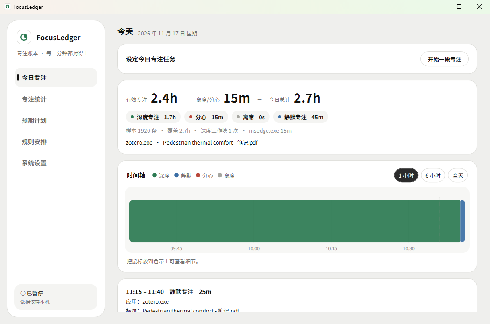
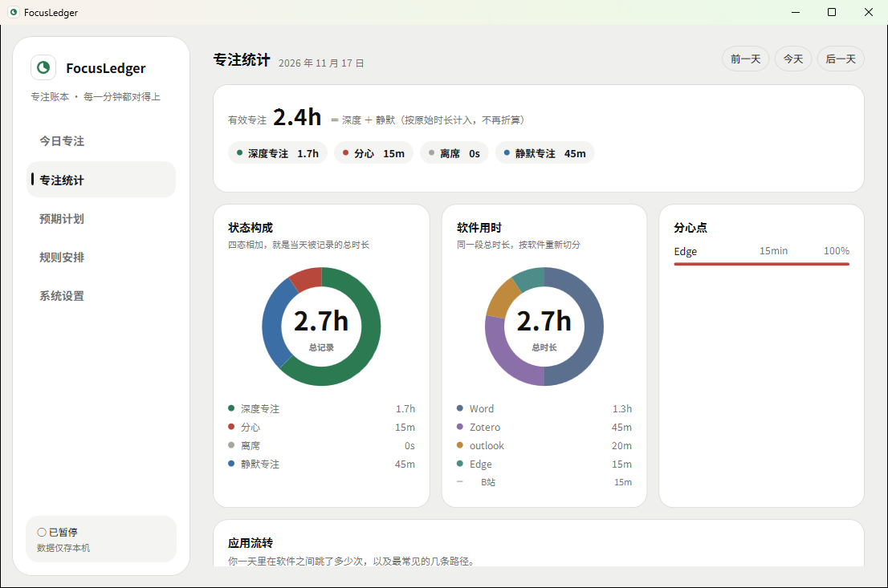
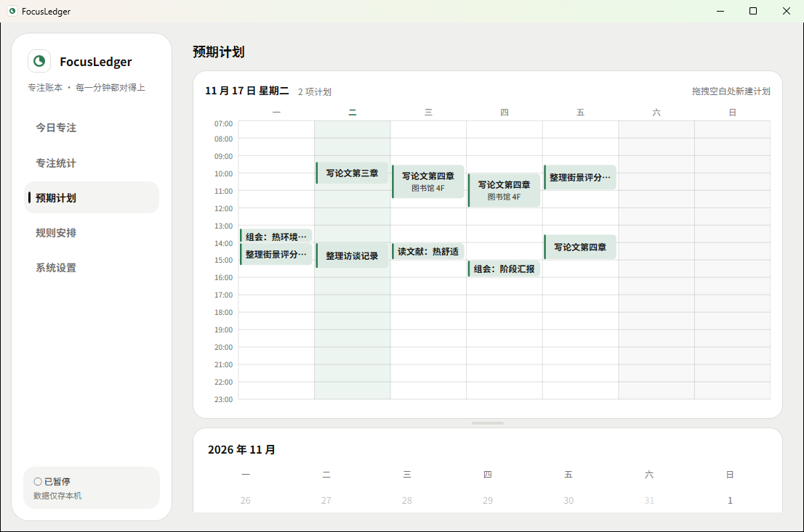

# FocusLedger

> **Focus ledger · every minute accounted for**

You claim six hours of focus. The ledger shows three, and you cannot say where the rest went.
FocusLedger records what was actually in front of you — the window, the movement on screen,
keyboard and mouse activity, media playback — judges the time as four states, and reconciles
your claim against the evidence. Recording answers *how long*; judgment answers *whether it
counted*; reconciliation answers *where the gap went*.

**Status:** v0.9 development build (2026-11-03). Build from source; no signed installer yet.

## What it does

| | |
|---|---|
| **Local only** | No network code in the app. No account, no telemetry, no crash reporting. |
| **Four-state judgment** | Deep / silent / distracted / away. Without positive evidence, time counts as away. |
| **Reconciliation** | Import a timer CSV, align claimed intervals with observed states, and split the gap into away, distracted, untracked, and partial credit. |
| **Planner** | Drag on a week view to add plans; month calendar, repeat rules, overlap rejection, place and link notes. |
| **Bilingual UI** | Chinese and English, switched live; the preference stays on this machine. |

## How it differs

| Tool | Records | Judges engagement | Claim vs evidence |
|---|---|---|---|
| RescueTime | App / site time | Infers from app category | No |
| Toggl | Time you start manually | No | No |
| ActivityWatch | App / window / idle | AFK only | No |
| **FocusLedger** | App + window title + visual change + media + input + lock | **Four states, every segment traceable** | **Yes, with an attributed gap** |

## Screenshots

> Captured with demo data. No real usage is shown.



**Today**: effective focus = deep + silent. The band is coloured by state; click any segment to see why it was classified that way.



**Report**: four-state composition, time per app, where the distraction went, and how often you jumped between apps.



**Plan**: drag on an empty slot to create; supports recurrence, time-conflict rejection, month view with holidays.

## Privacy (short version)

- **No network.** The app process makes no outbound requests. No telemetry, no crash uploads.
- **No content.** Keyboard hooks only increment counters; no key codes, no mouse coordinates,
  no clipboard, no file contents, no browser history.
- **Visual hash only.** Every five seconds the foreground window is reduced to a 9×8 grayscale
  image and a 64-bit hash. The image buffer is discarded; nothing is written to disk.
- **Stored here:** `%LOCALAPPDATA%\FocusLedger\data.db`. Raw samples are kept for 14 days by
  default and the retention period is configurable in Settings.
- **Titles stay local.** Window titles (and media titles reported by Windows) are stored on this
  machine to classify activity. Exports do not include window titles.
- **Under your control.** Pause from the tray, exclude an app, or delete all collected data in
  Settings.

The full policy is in [PRIVACY.md](PRIVACY.md) (Chinese). Security reports: [SECURITY.md](SECURITY.md).

## Build and run

Requires Windows 10 2004 (19041) or later and the .NET 8 SDK.

Do not call `dotnet` directly on the development machine: the `dotnet` on `PATH` has no SDK.
`tools\dev.ps1` picks the SDK under `%USERPROFILE%\.dotnet` and is the supported entry point.

```powershell
powershell -ExecutionPolicy Bypass -File .\tools\dev.ps1 build
powershell -ExecutionPolicy Bypass -File .\tools\dev.ps1 run
powershell -ExecutionPolicy Bypass -File .\tools\dev.ps1 test

# self-contained single file, output in dist\
powershell -ExecutionPolicy Bypass -File .\tools\dev.ps1 publish
```

## Command line

```powershell
$cli = ".\src\FocusLedger.Cli\bin\Debug\net8.0-windows10.0.19041.0\focusledger.exe"

& $cli report
& $cli capture --minutes 60
& $cli import --file .\toggl.csv
& $cli reconcile
& $cli report --range 30d --export md --out report-30d.md
```

`report --range 30d --export md` writes a publishable Markdown report: totals, daily rows,
weekday rhythm, app time, and top distractions. It contains app names, not window titles.

## License

[Mozilla Public License 2.0](LICENSE), per ADR-003: file-level copyleft, so modifications to
FocusLedger source files must stay open, while the code can be used by a larger product.

**The name and logo are not covered by the license.** "FocusLedger", "专注账本", the app icon,
and the logo remain trademarks of the author. Forks and redistributions must use a different
name and icon.

This is not an employee-monitoring tool. The person being recorded must be the person using it.
