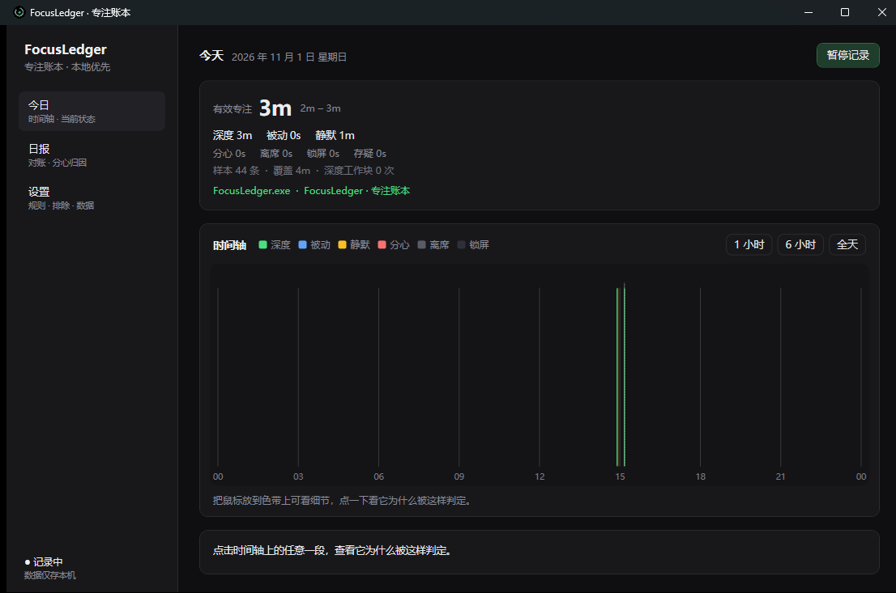

# FocusLedger · 专注账本

> 一个本地优先的注意力审计工具：自动记录你在电脑上的每一分钟，用多源证据判断你是否真的在投入，
> 并每天给你一份「声称 vs 实证」的对账报告。

**当前状态**：**M2 完成** —— 判定引擎、采集器、存储、命令行日报、桌面界面（托盘 / 时间轴 / 日报 / 设置）
均已跑通。规则编辑页与「番茄钟对账」待后续里程碑。



---

## 为什么做这个

番茄钟会骗你。计时器一开，你就"在学习"——哪怕你已经去泡咖啡、在刷手机、在发呆。
于是你每天自报 6 小时专注，实际可能只有 3 小时，而你**不知道差的 3 小时去了哪里**。

FocusLedger 不信任任何一个单一信号：

- 计时器会骗人（人走了没停表）
- 前台窗口会骗人（Stata 开着，人在刷手机）
- 键鼠活动会骗人（无意义晃鼠标、机械翻页）
- 屏幕变化会骗人（视频在播但人在做饭）
- 无输入也不等于没学习（读一页 PDF、盯着代码思考五分钟）

它做的事情是：**采集多源弱信号 → 推断状态与置信度 → 把"你声称的"和"证据支持的"并排摆出来**。

---

## 和同类产品的区别

| | 记录了什么 | 判断是否投入 | 声称 vs 实证对账 |
|---|---|---|---|
| RescueTime | 应用 / 网站用时 | 无，只有分类 | 无 |
| Toggl | 你手动宣称的时间 | 无 | 无 |
| ActivityWatch | 应用 / 窗口 / 键鼠空闲 | 部分，仅 AFK | 无 |
| 番茄 Todo | 你按下的计时器 | 无（这正是痛点） | 无 |
| **FocusLedger** | 应用 + 窗口 + 画面变化 + 媒体播放 + 键鼠 + 锁屏 | **七状态 + 置信度区间** | **有，且可归因** |

护城河不在"记录"，在"判定"和"对账"。记录层永远会被开源项目做平，判定层不会。

---

## 七个状态

| 状态 | 含义 | 计权 |
|---|---|---|
| `active_focus` | 有输入、前台属任务类、画面在变 | 1.0 |
| `passive_focus` | 无输入但在消费任务内容（网课、长文） | 0.7–0.85 |
| `silent_focus` | 无输入无变化，但在任务应用里（思考/阅读） | 0.3–0.7，低置信 |
| `off_task` | 在娱乐/社交/购物，或主动分心 | 0，另计"分心时长" |
| `idle_away` | 人不在，无媒体播放 | 0，另计"离席时长" |
| `locked` / `asleep` | 锁屏、睡眠、关机 | 不进入任何统计 |
| `ambiguous` | 信号冲突或不足 | 0.5，进入日终复核队列 |

日报永远写成 `有效专注 4.2h [3.8–4.6]`，不写假精确的 `4.2h`。

---

## 杀手级功能：对账

导入番茄 Todo 的 CSV，把它记录的"专注区间"和 FocusLedger 的"实证状态"在时间轴上对齐：

```
你声称     ████████████████████████████  6.0h
实证支持   ████████████░░░░░░            3.1h
差额 2.9h  =  离席 1.4h  +  分心 0.9h  +  存疑 0.6h
```

这张图像体检报告，能截图、能分享、能让人第一次看清自己的时间去哪了。

---

## 技术栈

- **.NET 8 + WPF**（Windows 优先；托盘常驻 + 单文件发布 + Velopack 自动更新）
- **SQLite**（`Microsoft.Data.Sqlite` + Dapper），全部本地
- 采集层直调 **Win32 / WinRT**（前景窗口、空闲、画面哈希、媒体播放、会话锁屏）
- 判定引擎是**纯 C#、零系统依赖**，可脱离 Windows 单独跑单元测试

> 为什么不是 Tauri：本机没有 Rust 与 MSVC 构建工具链，安装成本约 3–4 GB 且可能需要管理员权限。
> 详见 [docs/04-architecture.md](docs/04-architecture.md)。

---

## 文档

| 文档 | 内容 |
|---|---|
| [docs/00-vision.md](docs/00-vision.md) | 定位、用户、差异化、商业模式、命名 |
| [docs/01-spec.md](docs/01-spec.md) | 完整产品规格（要做什么） |
| [docs/02-state-machine.md](docs/02-state-machine.md) | 状态判定模型、阈值、验收场景矩阵 |
| [docs/03-data-model.md](docs/03-data-model.md) | SQLite 表结构、保留策略、导出格式 |
| [docs/04-architecture.md](docs/04-architecture.md) | 架构、技术选型、模块边界、线程模型 |
| [docs/05-roadmap.md](docs/05-roadmap.md) | M0–M4 里程碑与验收方式 |
| [docs/06-decisions.md](docs/06-decisions.md) | 决策记录（ADR） |
| [docs/07-privacy.md](docs/07-privacy.md) | 隐私红线、合规、安全设计 |
| [docs/m0-findings.md](docs/m0-findings.md) | M0 信号探针实测记录 |
| [docs/m1-report.md](docs/m1-report.md) | M1 完成报告与已知缺口 |
| [docs/m2-report.md](docs/m2-report.md) | M2 界面完成报告与已知缺口 |
| [AGENTS.md](AGENTS.md) | 给实现型 AI 的工作契约（怎么干） |

---

## 快速开始

```powershell
# 构建并跑测试
powershell -ExecutionPolicy Bypass -File .\tools\dev.ps1 build
powershell -ExecutionPolicy Bypass -File .\tools\dev.ps1 test

# 采集 1 小时（写入 %LOCALAPPDATA%\FocusLedger\data.db）
.\src\FocusLedger.Cli\bin\Debug\net8.0-windows10.0.19041.0\focusledger.exe capture --minutes 60

# 出报告
.\src\FocusLedger.Cli\bin\Debug\net8.0-windows10.0.19041.0\focusledger.exe report
```

样例输出：

```
2026-11-01   有效专注 4.2h [3.8–4.6]

  深度 3.1h  |  被动 1.1h  |  静默 0.6h
  分心 0.9h  |  离席 1.4h  |  锁屏 2.1h  |  存疑 0.0h

  深度工作块 5 次，最长 52 分钟
  应用切换 87 次
```

---

## 隐私立场

默认 100% 本地、零网络请求。不记录按键内容、不记录剪贴板、不记录文件内容、默认不落盘任何截图。
托盘常驻可见，一键暂停，一键排除。详见 [docs/07-privacy.md](docs/07-privacy.md)。

这个品类里**信任就是产品**。任何一条越界，项目就死了。

---

## 许可证

[Mozilla Public License 2.0](LICENSE)。文件级 copyleft：允许被更大的商业产品引用，
但 FocusLedger 自身的修改必须保持开源，且不允许把本项目私有化后再分发。

---

## 状态徽章（开源后启用）

`build` · `tests` · `license` · `platform: windows`
