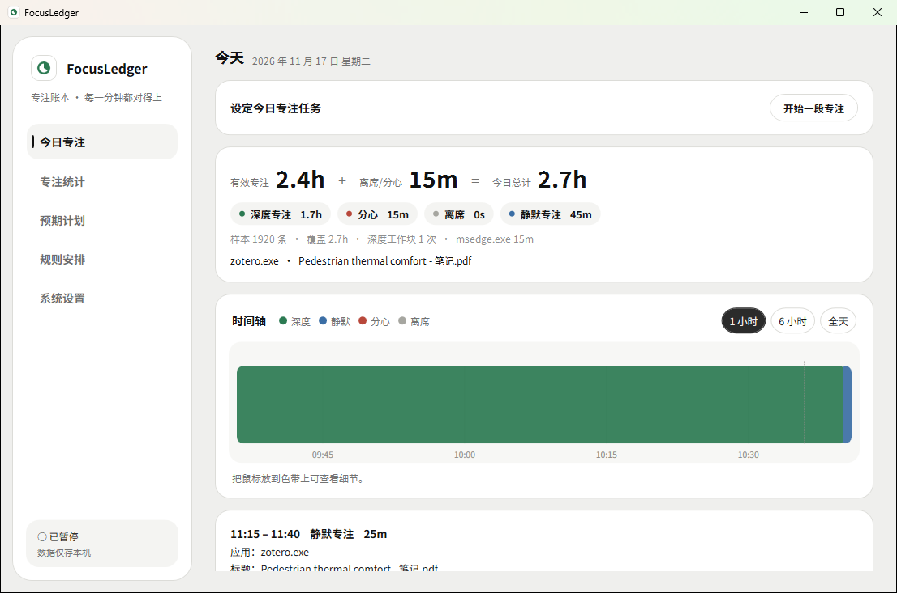
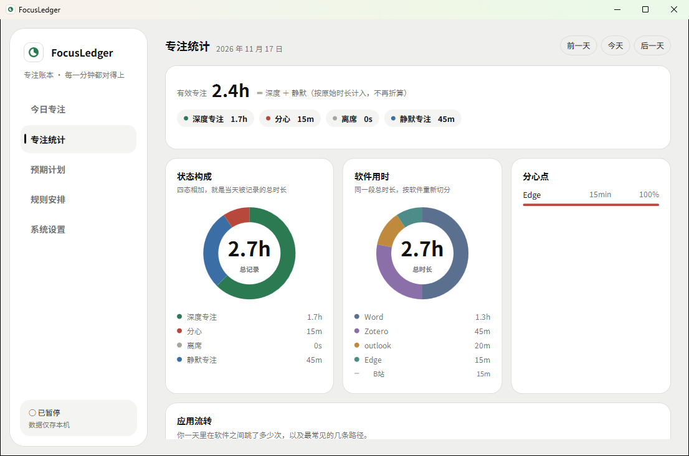
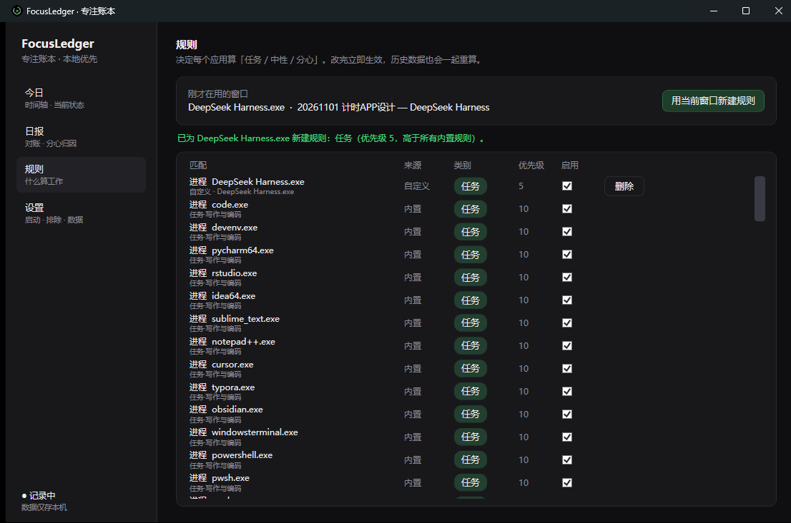

# M2 完成报告

**日期**：2026-11-01
**状态**：✅ 完整交付（含 M2.5 规则编辑）
**范围**：托盘常驻 + 今日时间轴 + 日报界面 + 设置页 + 规则编辑

---

## 1. 界面

### 今日

- **有效专注**大字 + 置信区间（`3m` / `区间 2m – 3m`）
- 五段式拆分：深度 / 被动 / 静默 / 分心 / 离席 / 锁屏 / 存疑
- **自绘时间轴**：按状态着色，低置信段降低不透明度，整点刻度，虚线为当前时刻
- 三个缩放档：1 小时 / 6 小时 / 全天
- 悬停显示该段的应用与标题；点击在底部展开解释卡（应用、分类、标题、权重区间、置信、命中规则）

### 日报

日期可前后翻页，「今天」一键回到当日；分心归因列出 Top 应用与占比。

### 设置

- 开机自启（写 `HKCU\...\Run`，无需管理员）
- 原始样本保留天数
- 排除列表（默认已排除 `FocusLedger.exe`，否则会记录自己在记录）
- 导出今日 CSV（UTF-8 BOM，Excel 直接可读）
- 删除全部数据（二次确认 + `VACUUM`）

---

## 2. 托盘

- 常驻图标：记录中为绿色环，已暂停为灰色环（运行时绘制，不依赖资源文件）
- 双击打开面板
- 右键菜单：打开面板 / 暂停记录 / 排除当前应用 / 退出
- 关闭窗口不退出，收进托盘（`ShutdownMode = OnExplicitShutdown`）

---

## 3. 实机验证

用 UI Automation 驱动真实控件，逐个确认：

| 验证项 | 方法 | 结果 |
|---|---|---|
| 三个页面渲染 | PrintWindow 截图 | ✅ 见上图 |
| 时间轴随数据增长 | 采集后刷新 | ✅ 15:00 附近出现色带 |
| 暂停 | 点「暂停记录」 | ✅ 按钮变「开始记录」，侧栏变「○ 已暂停」 |
| 恢复 | 点「开始记录」 | ✅ 恢复采集，进程存活 |
| 排除自身 | 检查设置页 | ✅ 列表中出现 `FocusLedger.exe` |
| 窗口关闭行为 | 代码路径 | ⏳ 未手工验证（应收入托盘） |

> 截图用的是 `PrintWindow`，因为 WPF 窗口被浏览器遮挡时 `CopyFromScreen` 会拍到桌面。

---

## 4. 实现要点

| 决定 | 原因 |
|---|---|
| WPF + 手写暗色主题，不引 UI 框架 | 少一个依赖、少一处 API 变动风险；需要用到的只是色板与按钮模板 |
| 托盘用 `System.Windows.Forms.NotifyIcon` | 与 WPF 共用进程，零额外依赖 |
| 时间轴自绘（`FrameworkElement.OnRender`） | 色带是产品脸面，图表库反而难控 |
| 同时启用 WPF 与 WinForms | 会引入 `System.Drawing` / `System.Windows.Forms` 的隐式 using，与 WPF 的 `Brush`/`Color`/`Point`/`UserControl` 冲突，已在 csproj 中 `<Using Remove>` |
| 界面每 5 秒重建一次判定段 | 1.7 万样本重算 < 100ms，比重算缓存更简单且永不过期 |

---

## 5. 已知缺口

| 缺口 | 影响 | 计划 |
|---|---|---|
| **首启隐私同意页未做** | 目前启动即记录。开源发布前必须补 | M4（硬性） |
| **内存 190MB** | 超出 150MB 预算约 27%（WPF 基线即 ~120MB） | 后续排查：时间轴每帧新建 Brush、每 5 秒重建段对象 |
| 时间轴悬停气泡位置固定 | 固定画在左上角，不跟随鼠标 | 体验优化 |
| 无「意图声明」 | M3 的差异化功能 | M3 |
| 无对账（番茄 CSV） | M3 的核心传播点 | M3 |

---

## 6. M2.5 · 规则编辑

### 为什么先做这个

规则不准，M3 的对账数字也不可信。用户最需要的其实不是更多统计，
而是能说一句「这个应用算工作」并且立刻看到结果。

### 关键设计：改规则要能改历史

初版的判定用的是**采集时存下的 `c_value` 快照**——这意味着用户改了规则，
昨天的数据纹丝不动，规则编辑就变成了摆设。

改成：`FeatureAggregator` 在聚合时**按当前规则重新推导上下文**，
逐样本调用 `rules.Match(app, title)`。于是：

- 改一条规则 → 今天、昨天、上周的所有报告立刻跟着变
- 规则存在 SQLite，内置规则留在代码里（可以随版本升级）
- 不信任历史分类，只信任当前规则

代价是每次刷新要重跑一遍规则匹配（3 分钟数据 < 5ms，一整天约 17k 样本仍在百毫秒内）。

### 能做什么

| 操作 | 说明 |
|---|---|
| 用刚才的窗口新建规则 | 取「打开面板之前那个窗口」，直接建一条优先级 5 的进程规则，高于所有内置规则 |
| 点击类别循环切换 | 任务 → 中性 → 分心，仅限自定义规则 |
| 启用 / 停用 | 内置与自定义都可以；停用内置规则的状态存 `meta` 表 |
| 删除 | 仅自定义规则 |

内置规则不给直接改类别，是为了让「默认规则包」保持可升级。
想覆盖某条内置规则，就新建一条优先级更高的自定义规则——语义清晰，实现也简单。

### 验证

新增 3 个回归测试（总计 27 个，全绿）：

| 测试 | 断言 |
|---|---|
| `ChangingRule_ReclassifiesHistoricalSamples` | 同一批"中性"样本，加规则后权重从 0.60 变 1.00 |
| `DisablingBuiltinRule_FallsBackToDefault` | 停用微信规则后，从"分心"落回"中性" |
| `UserRuleWithLowerPriorityWinsOverBuiltin` | 优先级 5 的自定义规则盖过优先级 80 的内置浏览器规则 |

UI 侧用自动化点过一遍：新建规则 → 出现在列表首位 → 删除 → 列表恢复。

---

## 7. 下一步（M3）

1. 意图声明：开始时声明「接下来 50 分钟写论文」，结束算遵守率
2. 番茄 Todo CSV 导入 + 时间轴对齐 + 差额归因
3. 日终 60 秒复核：低置信区间快速标注
4. 对账卡导出 PNG（可分享）

M3 做完，这个产品最核心的「声称 vs 实证」就闭环了。
