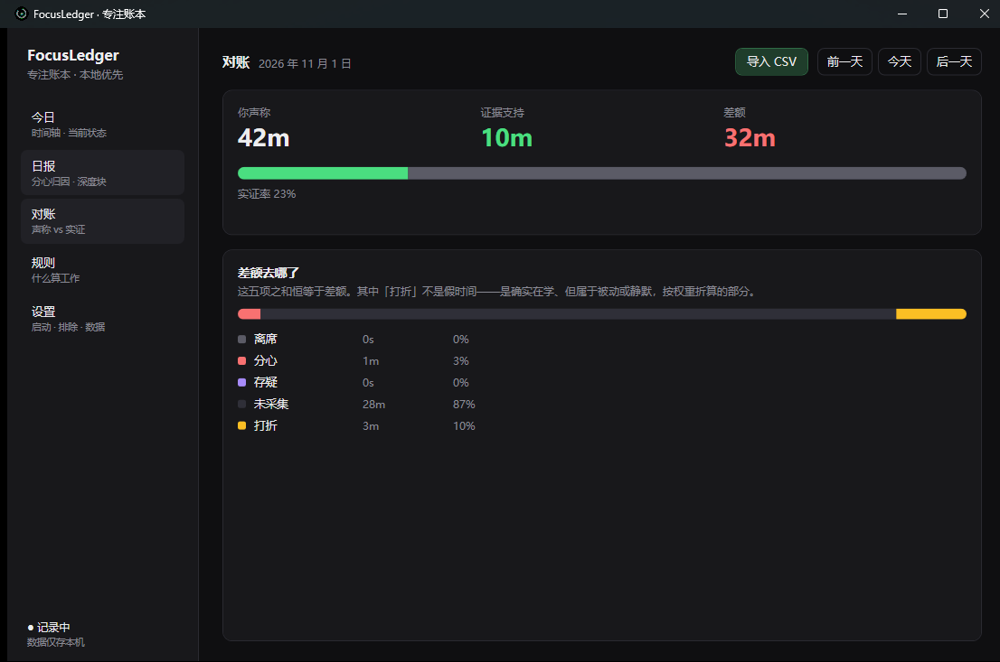
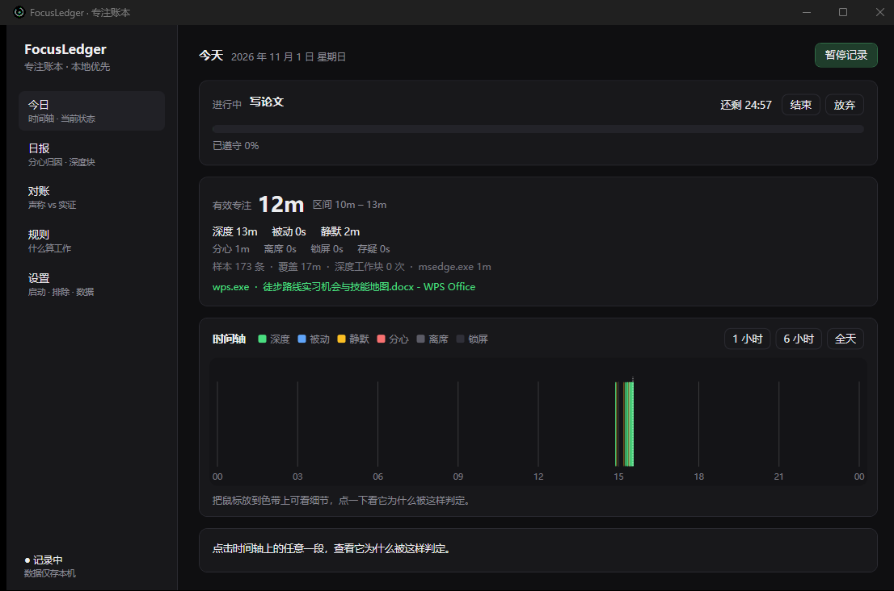

# M3 完成报告（第一部分：对账）

**日期**：2026-11-01
**状态**：✅ 完成（对账 + 意图声明）；日终复核与对账卡导出未做（见 §6）
**范围**：CSV 解析 + 时间轴对齐 + 差额归因 + 意图声明 + 对账页面

---

## 1. 界面



三个数字排在一起：**你声称 42m / 证据支持 10m / 差额 32m**，下面一条比例条直接给出实证率。
再往下是「差额去哪了」——五类归因，每类带颜色、时长、占比。

---

## 2. 核心：差额分解的恒等式

对账最容易做错的地方是**归因不闭合**：算出差额 32 分钟，列出来的几项加起来只有 25 分钟，
剩下 7 分钟说不清。这种产品用户看两次就不信了。

所以这里的分解是严格闭合的：

```
差额 = 离席 + 分心 + 存疑 + 未采集 + 打折
```

推导：

```
声称   = 与采集数据重叠的部分 + 未采集
重叠   = 深度 + 被动 + 静默 + 分心 + 离席 + 存疑
实证   = 深度×1.0 + 被动×0.85 + 静默×0.7 + 0×其余
差额   = 声称 − 实证
       = 未采集 + 分心 + 离席 + 存疑 + (深度+被动+静默 − 实证)
                                  └────────── 这一项就是「打折」
```

**「打折」是这套模型里最重要的一个概念**。它指"确实在学习，但因为是被动观看或静默思考，
只能按权重折算"的部分。它既不是浪费，也不是全额有效——必须单独列出来，
否则要么高估（算全额），要么冤枉用户（算进"分心"）。

`Reconciler` 里用 `WeightLossSeconds` 表达，并有测试保证 `AttributedGapSeconds == GapSeconds`。

---

## 3. CSV 解析：宽容优先

各家导出格式不统一，所以解析器按"能认就认、认不出就跳过并告知"设计：

| 支持 | 说明 |
|---|---|
| 开始 + 结束 | `开始时间,结束时间` |
| 开始 + 时长 | 时长支持 `25`、`25分钟`、`00:25:00` |
| 日期 + 时间 | 只有 `HH:mm` 时用「日期」列补齐；跨零点自动加一天 |
| 分隔符 | 逗号 / 制表符 / 分号 |
| 编码 | 自动去掉 UTF-8 BOM |
| 脏数据 | 跳过并汇报「跳过 N 行」，不影响其余记录 |

表头识别关键字：开始/start/起始、结束/end/完成、时长/duration、日期/date、任务/task/label/名称。

**幂等**：按文件内容 SHA-256 判重，同一份文件重复导入不会产生重复记录。

---

## 4. 验证

### 4.1 单元测试

新增 12 个测试（总计 **39 个，全绿**）：

| 文件 | 覆盖 |
|---|---|
| `TimerCsvParserTests`（7） | 起止列、时长列、日期+时间、制表符、脏数据跳过、空文件、结束早于开始 |
| `ReconcilerTests`（5） | 完全命中、跨活跃与离席按比例切分、无数据算未采集、被动按 0.85 折算、空输入 |

### 4.2 真实链路

用一份和今天采集数据重叠的 CSV 跑通 CLI：

```
$ focusledger import --file pomodoro-demo.csv
已导入 2 条声明，合计 42m。

$ focusledger reconcile
2026-11-01  对账

  声称 42m    实证 10m    差额 32m（77%）

  离席   0s
  分心   1m
  存疑   0s
  未采集 28m
  打折   3m  ← 确实在学，但属被动/静默，按权重折算
  ------------------------------------
  合计   32m
```

「未采集 28m」占比高是因为演示 CSV 覆盖 14:50–15:32，而今天只在 15:00 前后采了十几分钟。
真实使用一整天后，这一项会很小。

---

## 5. 实现清单

| 层 | 内容 |
|---|---|
| Core | `TimerClaim` / `TimerCsvParser` / `Reconciler` / `ReconcileResult` |
| Storage | `timer_imports` + `timer_claims` 表；按内容哈希判重；按日期范围加载 |
| CLI | `focusledger import --file X.csv`、`focusledger reconcile` |
| App | 对账页：日期翻页、导入、清除导入、双比例条、五项归因表 |

---

## 6. 意图声明



对账是**事后**的：一天结束，你被告知"声称 6 小时，实证 3.1 小时"。
意图声明把它变成**事前**：开始前说"接下来 25 分钟写论文"，结束时拿到回执。

两者共用同一套判定与权重，只是时间窗口的来源不同——一个来自 CSV，一个来自你自己的承诺。

### 交互

1. 点「开始一段专注」→ 填标签（默认"写论文"）+ 选 25 / 50 / 90 分钟
2. 进行中：左上显示标签，右上倒计时，下方一条进度条 + 实时遵守率
3. 到点自动结算；也可以「结束」（提前完成）或「放弃」

### 遵守率的定义

```
遵守率 = 窗口内有效专注秒数 / 窗口秒数
```

有效秒数沿用同一套权重：深度 1.0、被动 0.85、静默 0.4–0.7。
所以"看了 25 分钟网课"会得到 85%，而不是 100% 或 0%——和日报、对账完全一致的口径。

### 可信度保护

如果窗口内超过 30% 的时间没有采集数据（程序没跑、被排除、锁屏），
回执会明确写一句「其中相当一部分没有采集数据，这个数字不太可信」。

宁可说"我不知道"，也不要给一个假的精确数字——这是整个产品的不变量 I1。

### 测试

新增 6 个测试（总计 **45 个，全绿**）：完全专注=100%、一半离席=50%、被动=85%、
无数据时显示未采集比例、中途评估只算已过时间、窗口外的段不计入。

---

## 7. 还没做的（M3 剩余）

| 项 | 说明 |
|---|---|
| **日终 60 秒复核** | 列出低置信区间让用户一键标注，标注结果反哺规则 |
| **对账卡导出 PNG** | 当前只能截图，没有一键生成可分享的图 |
| 单条声明的明细 | 现在只给汇总，看不到「第 3 个番茄钟被判定成了什么」 |
| 意图与对账未打通 | 意图回执目前只在今日页显示，没有进入对账页的历史列表 |

---

## 8. 下一步

优先做**意图声明**：它和对账是同一个「声称 vs 实证」框架，只是把时间点提前到事前。
做完之后，产品从「每天被告知一次真相」变成「每次开始时就有承诺、结束时就有回执」。
